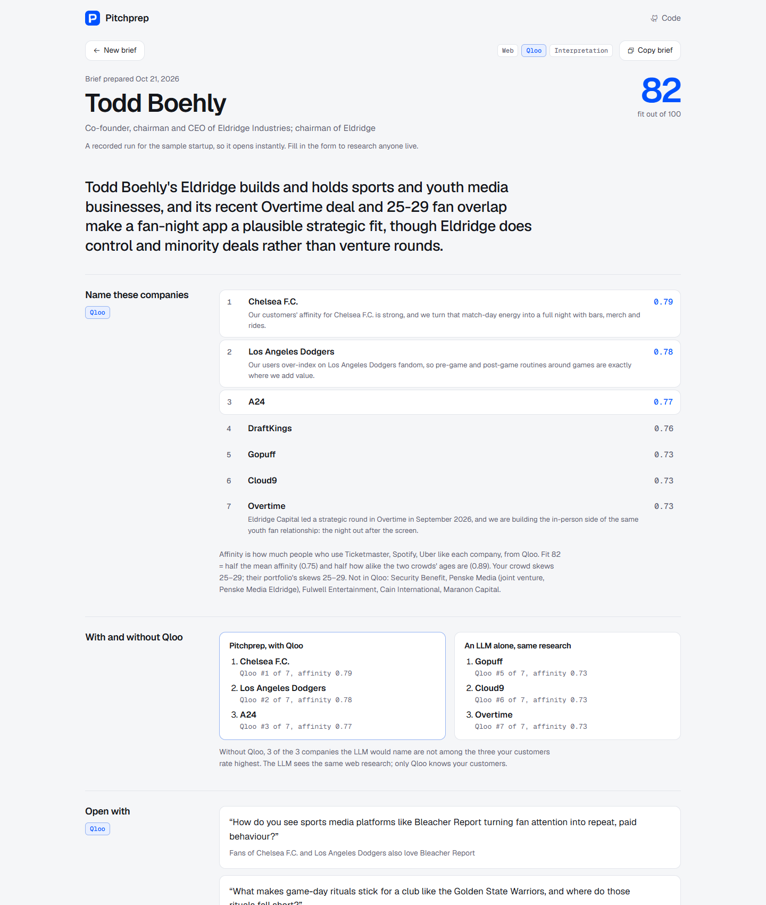

# Qloo hackathon sites

Four small apps built on [Qloo](https://www.qloo.com)'s taste graph for the [Qloo Agentic Hackathon](https://qloo.devpost.com). Each takes what people love and turns it into a decision: what to say to an investor, what to build in a room, what to say next in a conversation.



| App | In one line | Instant example | More |
|---|---|---|---|
| **Pitchprep** | Research an investor with cited sources, then Qloo shows which of their companies your customers already love | `/?demo=boehly` | [docs/pitchprep.md](docs/pitchprep.md) |
| **Openhere** | Pick a real space on the globe and say who it's for. An agent redesigns the photo from what those people love, then you walk inside | `/?demo=redbull-bridgers` | [docs/openhere.md](docs/openhere.md) |
| **Roomful** | Name a few things you love and walk into the room they make, with the music on | `/?demo=rain` | [docs/roomful.md](docs/roomful.md) |
| **SmallTalk** | It hears what the other person mentions and tells you what to say next, on a phone, display glasses or a Quest headset | `/?demo=sample` | [docs/smalltalk.md](docs/smalltalk.md) |

Each app has a short explainer video, built from real captures of the app: [Pitchprep](docs/video/pitchprep.mp4), [Openhere](docs/video/openhere.mp4), [Roomful](docs/video/roomful.mp4), [SmallTalk](docs/video/smalltalk.mp4).

Every app shows the same proof on screen: **with and without Qloo**. The same question goes to an LLM alone, and each of its picks is checked against what Qloo returned. Without Qloo, 0 of 8 picks hold up for the Openhere live-music room, 0 of 8 for the Roomful rain room, and 1 of 6 SmallTalk suggestions fit; for Pitchprep, an LLM alone names the three portfolio companies Qloo ranks lowest.

The repo also holds Taste Lab (`lab/`), the raw Qloo explorer the project started from. It is not part of the submission.

The examples open in seconds. Each is a recording of a real run (live Qloo, LLM and image calls) replayed at reading speed. Every site also runs live on your own input.

## Why Qloo is the product, not a feature

Ask a chatbot what a bar in Parkdale should look like and it gives the answer it would give for any neighbourhood. Here the audience comes from Qloo: a point on a map, a list of favourites, an investor's portfolio, or a few things someone mentioned, turned into the decor, music, brands, places and demographics that crowd actually rates. The model chooses among what Qloo returned and writes the prose. Scores are computed in code from Qloo's numbers. **Any name the model cites that Qloo did not return in that run is flagged as unverified on screen.**

Qloo endpoints used: Insights (`/v2/insights` with entity, tag, demographics and heatmap types; `signal.location`, `signal.interests.entities`, `filter.results.entities`, `feature.explainability`, `filter.popularity.max`), Search, Tags and Analysis Compare.

## Run it

Node.js 22 or newer. Nothing to install.

```bash
cp .env.example .env
```

Add your keys to `.env`. The instant examples replay with no keys at all; live runs need at least `QLOO_API_KEY` and `QLOO_API_HOST`.

```bash
npm run dev
```

That starts all five sites on ports 3300 to 3304. To run just one:

```bash
npm run start:pitch
```

| Variable | What it unlocks |
|---|---|
| `QLOO_API_KEY`, `QLOO_API_HOST` | Every live run. Hackathon keys use `https://hackathon.api.qloo.com` |
| `OPENROUTER_API_KEY` (or `ANTHROPIC_API_KEY`, `OPENAI_API_KEY`) | The agent, the briefs and web research. Cheap by default: Claude Haiku 5.5, plus Gemini 2.5 Flash Lite for SmallTalk's live turns. `LLM_MODEL` and `LLM_FAST_MODEL` take any OpenRouter model (OpenAI, Gemini, Claude) |
| `FAL_KEY` | Redesigns and room paintings (GPT Image 2.5 Flare), the live walkthrough (Lingbot World 2), speech to text (ElevenLabs) |
| `REALTYAPI_KEY` | Optional: live commercial listings near the clicked point in Openhere |
| `PRUNAAI_KEY`, `WORLDLABS_API_KEY` | Optional fallbacks: Pruna image edits, World Labs splat worlds |

## Tests

```bash
npm test
```

The tests use mock upstreams. They cover the documented Qloo parameters, the Openhere agent and activation loops, Pitchprep and SmallTalk, site isolation (each site serves only its own pages and API), that every recorded example replays with no keys and only local images, rate limits, origin checks and key redaction.

## Deploy

One repo, one service per app. Every service runs `npm start`; one variable picks the app: `SITE=pitch` (Pitchprep), `openhere`, `room` (Roomful) or `talk` (SmallTalk). There is no build step, so Railway, Render and Fly all work, and `PORT` is honoured. Keys stay on the server. Per-IP and daily caps (`AGENT_RUNS_PER_HOUR` and the rest in `.env.example`) protect the paid APIs on a public demo.

## Layout

```
server.js        one HTTP server, gated per site (the `sites` map)
lib/qloo.js      the Qloo client every site shares
lib/agent.js     Openhere's tool-using agent (tools in lib/tools.js)
lib/room.js      Roomful
lib/pitch.js     Pitchprep
lib/talk.js      SmallTalk
lib/demos.js     instant examples: load and replay recorded runs
data/demos/      the recorded runs
public/          front ends (no framework, no build)
lab/             Taste Lab
scripts/         record-demos.js, screenshots.js
video/           explainer videos built from real app captures (make.js)
test/            node --test suites
```

## License

[MIT](LICENSE). Sample-space photos in Openhere keep their own Creative Commons licences, credited per photo in [`data/spaces.json`](data/spaces.json). Generated images are labelled as generated.
