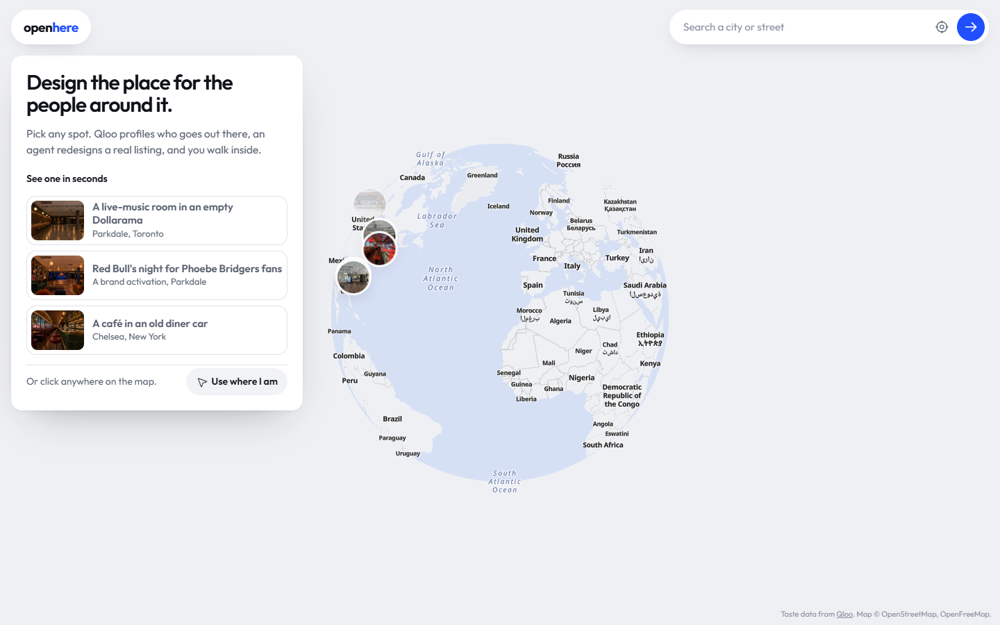
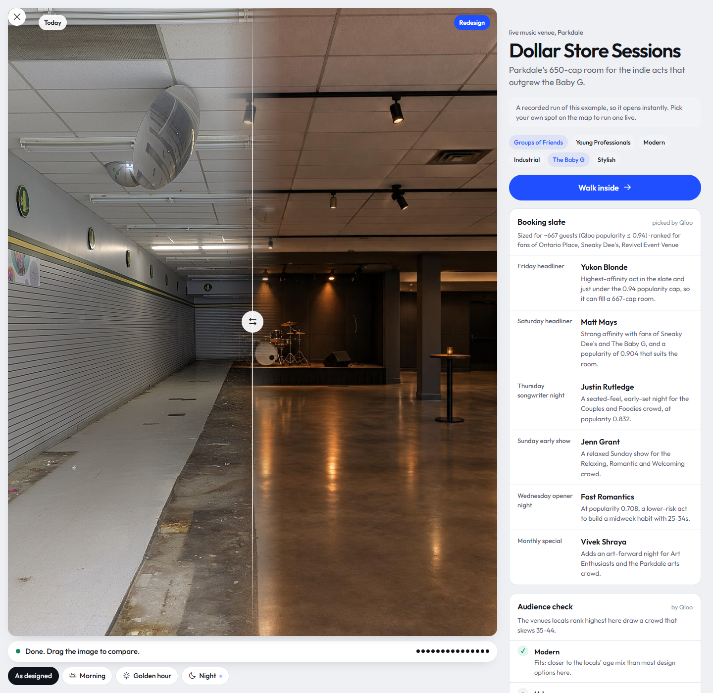

# Openhere


**Pick a real space on the globe. Say who it's for. An agent designs it from what those people actually love, paints it into the real photo, and lets you walk inside.**



Run it with `npm run start:openhere` (port 3300), or deploy with `SITE=openhere`.

## Judge in 60 seconds

1. Open the site and click **A live-music room in an empty Dollarama**. It is a recorded real run, so it opens in seconds.
2. Drag the wipe across the photo: the real empty room on the left, the redesign on the right.
3. Read **With and without Qloo** under the concept: an LLM's picks for the same brief, checked against what Qloo ranks for this crowd.
4. Scroll to **Why it looks like this**: every design choice names the Qloo signal behind it. Unverified names are flagged.
5. Click **Walk inside** to explore the redesign live (fal's real-time world model), or **In 3D or VR** to step into the redesign itself, lifted into 3D, with WASD or a headset.
6. Open **How the agent decided** for every tool call and Qloo request.

[Watch the explainer](video/openhere.mp4)

## Try it in 10 seconds

| Example | Link |
|---|---|
| Red Bull × Phoebe Bridgers fans, a pop-up in Parkdale, Toronto | `/?demo=redbull-bridgers` |
| A live-music room in a cleared Dollarama, Parkdale | `/?demo=live-music-parkdale` |
| A café in the Empire Diner car, Chelsea, New York | `/?demo=cafe-chelsea` |

Each one is a recorded real run. The studio opens with the before/after wipe, the concept, the with/without-Qloo check, and every design choice with the Qloo signal behind it. The seven Qloo data views behind the design sit under one Show toggle.

## With and without Qloo

The studio asks an LLM for the same brief with no tools, then checks each pick against Qloo's top results for that crowd. In the recorded Red Bull × Phoebe Bridgers run, **4 of the LLM's 8 picks hold up**; 2 are real but not ranked for these fans, and 2 are not in Qloo at all ("Fluorescent Aisle Nostalgia", "Glow-in-Dark Skeletons"). Everything Openhere itself picked came from Qloo's results, and anything that did not is flagged.



## Two ways to use it

| Mode | Who it's for | What Qloo decides |
|---|---|---|
| **Venues** | Anyone about to sign a lease: a restaurant, café, bar, live-music room, comedy club, sports bar or founders' café | What the people who go out near that address want a room to feel like, what they eat, drink and listen to, who to book, and which brands to partner with |
| **Brand activations** | Sponsorship and experiential teams: a brand's pop-up, booth or takeover for one event's fans, in a real room near the venue | How well the brand fits that fanbase, what the fans want a room to feel like, the playlist, the co-sponsors both audiences already love, local partners, and where the fans live around the venue |

### Venues: open the right thing here

1. Click anywhere on the globe (or use your location), choose what you want to open, then pick a real commercial listing nearby and the room to redesign. You can also upload a photo of a space you're touring.
2. The agent profiles the local audience with Qloo: who goes out near the address, the ambience and decor they favour, what they eat and drink, the venues they rate highest, the artists and brands they love.
3. It checks each design idea against the crowd. Qloo knows the age and gender skew of every decor and ambience tag; tags that draw a different crowd from the locals are dropped, and the swap is explained.
4. It finds the gap against nearby competitors, then redesigns the real photo (GPT Image 2.5 Flare, about 25 seconds), keeping the windows, columns, framing and camera angle so the before/after wipe is believable. Morning, golden-hour and night versions render in parallel.
5. For event venues it books the room: a slate of artists, comedians, teams or podcasts that people near that address already love, sized to the room's capacity, seeded with similar venues nearby.
6. **Walk inside.** fal's real-time world model (Lingbot World 2) streams a walkable world that starts from the redesign. Change the time of day while you walk.

### Activations: a brand's night for the fans who'll show up

Type a brand and an event (a headliner, a team, a show) and pick the room. The agent:

1. Resolves both audiences in Qloo: the event's fans and the brand's followers.
2. Measures the overlap: each side's demographics, how alike their age profiles are, how much their top-15 brands and artists overlap (Jaccard), and the combined-signal picks with `feature.explainability`, so each shared pick shows how much the fans and the followers each drove it. That becomes a **fit score out of 100** with the arithmetic shown.
3. Profiles the fans the way venue mode profiles a neighbourhood: ambience, decor, drinks, co-sponsors, playlist, places near the venue the fans rate, and a heatmap of where the fans live around the venue (drawn on the globe).
4. Checks the design tags against the fans' own skew, renders the room with the brand unmistakable in it, and finalises: concept, design choices, partners, playlist, run of show and fit. Partners and acts must be names Qloo returned; anything else is sent back once and then flagged.

## How the agent works

The LLM (Claude Haiku 5.5 through OpenRouter by default, or any model set in `LLM_MODEL`) runs a multi-step tool loop in [`lib/agent.js`](../lib/agent.js). It decides which Qloo questions to ask, reads the answers and adapts when a call comes back empty. Steps stream to the browser over server-sent events; **How the agent decided** opens the full reasoning, every tool call and the raw Qloo request log.

| Tool | What it calls |
|---|---|
| `get_listing` | The chosen space: rent, size, lease terms, walk and transit scores, plus a one-time vision survey of the photo (permanent architecture, camera, depth zones) |
| `local_taste_tags` | `/v2/insights?filter.type=urn:tag&signal.location=POINT(lng lat)&filter.parents.types=urn:entity:place&filter.tag.types=urn:tag:<facet>:qloo` |
| `local_venues` | `/v2/insights?filter.type=urn:entity:place&filter.location=POINT&filter.location.radius=…&filter.tags=<genre tag>` (tag resolved through `/v2/tags`) |
| `local_entities` | `/v2/insights?filter.type=urn:entity:artist\|brand\|…&signal.location=POINT` |
| `book_slate` | Sizes the room from the listing, caps `filter.popularity.max` so acts fit it, seeds `signal.interests.entities` with similar venues nearby |
| `check_audience_fit` | `filter.type=urn:demographics` for the design tags and for the crowd; cosine similarity of age profiles |
| `resolve_audience` | `/search` for the event and the brand |
| `audience_overlap` | Demographics of both sides, each side's top 15, combined signals with `feature.explainability=true`, and `/v2/analysis/compare` |
| `fan_taste_tags` | `filter.type=urn:tag&filter.parents.types=urn:entity:place&signal.interests.entities=<fans>` |
| `fan_favourites` | `filter.type=urn:entity:<type>&signal.interests.entities=<fans and/or followers>` with explainability |
| `fan_places` | `filter.type=urn:entity:place&filter.location=POINT&signal.interests.entities=<fans>` |
| `fan_heatmap` | `filter.type=urn:heatmap&filter.location=POINT&filter.location.radius=12000&signal.interests.entities=<fans>` |
| `render_redesign` | Photo edit with GPT Image 2.5 Flare on fal; the app appends a keep-list of the room's permanent structure |
| `finalize_concept` | Validates every cited signal, partner and act against the names collected during the run |

Without an LLM key, venue mode runs the same tools in a fixed order and labels the result as scripted.

## Live walkthrough

`/live` plays fal's `robbyant/lingbot-world-2` over WebRTC: `POST /ice` for TURN credentials, `POST /session` with one SDP offer, and `POST /session/heartbeat` every 5 seconds. The browser then talks to the GPU peer directly and sends movement, look and time-of-day prompts on a data channel. All three calls go through this server, so the fal key never reaches the browser, and the server stops renewing the heartbeat after `LIVE_MAX_SECONDS` to bound cost. With a World Labs key, a Gaussian-splat world with WebXR is the alternative.

## Spaces

- **Live listings (`REALTYAPI_KEY`):** LoopNet spaces for lease within about 1.5 miles of the point, with the full gallery (interiors first), rent, size and traffic counts. Each card credits LoopNet and links back.
- **Sample spaces:** five real rooms that are vacant or closed, with openly licensed Wikimedia Commons photos, credited in [`data/spaces.json`](../data/spaces.json). Their rents are illustrative.
- **Your own photo:** upload the space you're touring, pinned where you clicked.

## Tests

```bash
npm test
```

They run against fake Qloo, LLM, image and world-model services, so they need no keys. For Openhere they check:

```
✔ Qloo client sends documented taste-analysis and place parameters
✔ location signals use WKT points (longitude first) and tag responses normalise
✔ agent loop drives Qloo, image and finalize tools end to end and never leaks keys
✔ finalize_concept flags cited signals that Qloo never returned
✔ event venues get a booking brief, and slate acts are checked against Qloo results
✔ book_slate sizes the room, caps Qloo popularity and seeds with similar local venues
✔ check_audience_fit compares design tags with the crowd the top local venues draw
✔ activation mode: resolves both audiences, measures overlap with explainability, maps fans and grounds partners
✔ live walkthrough signals through fal WMA bridge, hides the key and enforces the time cap
✔ scripted mode runs without an LLM and is labelled as such
✔ API guards: origin, missing keys, validation and limits
✔ recorded examples replay without any API keys, with local images
```

## Known limitations

- Redesigns are generated images. They keep the room's structure but are not architectural drawings.
- The live walkthrough is a real-time world model: it improvises beyond the photo, and sessions are capped (`LIVE_MAX_SECONDS`) to bound cost.
- Sample-space rents are illustrative; live listings need a RealtyAPI key.
- Qloo describes crowds, not individuals; a fit score is a taste overlap, not a sales forecast.
