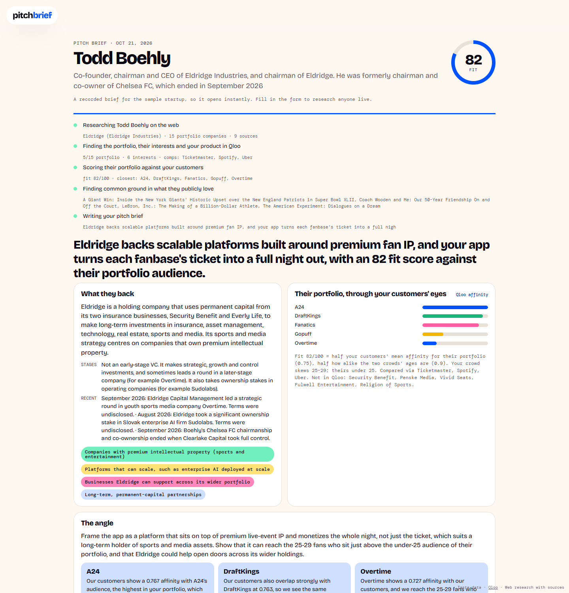

# Pitch Brief

**Before an investor meeting: research the investor with cited sources, then let Qloo say which of their companies your customers already love, and what to open with.**

Run it with `npm run start:pitch` (port 3302), or deploy with `SITE=pitch`.

## Try it in 10 seconds

The home page has a button for each of the hackathon's judges. Each opens a recorded brief for the same sample startup: *a live-events app that turns a concert ticket into a night out*, with Ticketmaster, Spotify and Uber as comparables. Deep links: `/?demo=boehly`, `/?demo=calacanis`, `/?demo=abrams`.

## How it works

1. **Research, cited.** Web search (through OpenRouter's web plugin) finds the investor's public, professional record: firm, thesis, stages, cheque size, portfolio, and the public things they host, own or recommend. Every fact links to its source. The prompt rules out family, home, health, finances and anything private.
2. **Resolve in Qloo.** The portfolio, their public interests and your comparable products become Qloo entities.
3. **Score the portfolio for your customers.** Qloo ranks every portfolio company for the audience of your comparables (`filter.results.entities`), and compares the two crowds' ages (`urn:demographics`). The **fit score** is half your customers' mean affinity for their portfolio and half how alike the crowds' ages are. The arithmetic is shown under the score.
4. **Find common ground.** What fans of the investor's public interests also love (books, podcasts, brands) becomes conversation openers.
5. **Write the brief.** An LLM writes the headline, the angle, which portfolio companies to name, deck fixes, openers, likely questions and what to avoid, from those facts only. Any company or opener it cites that Qloo did not return is marked *not from Qloo*.

The pipeline lives in [`lib/pitch.js`](../lib/pitch.js).
