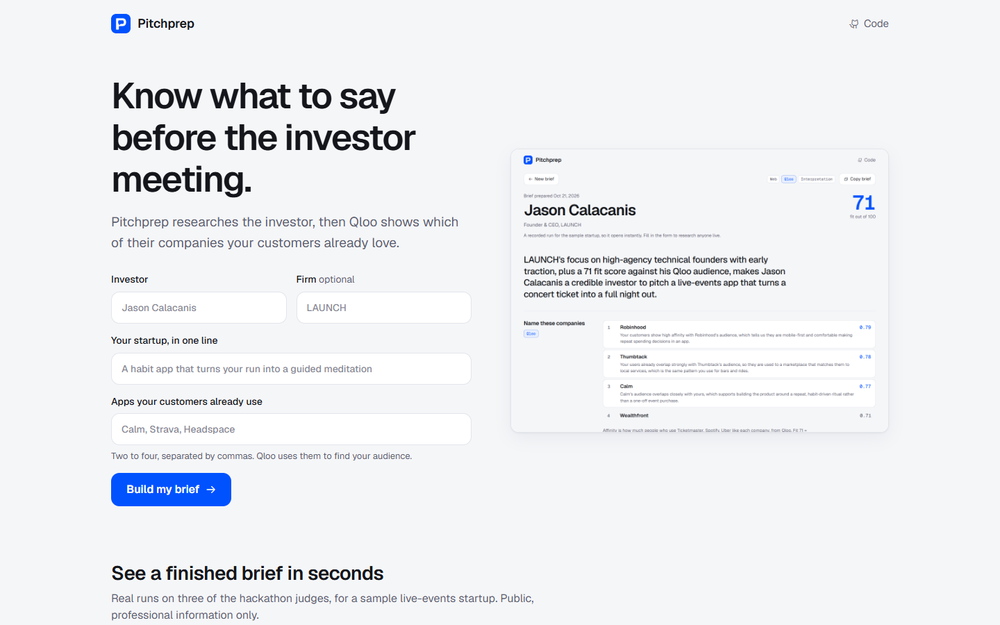

# Pitchprep


**Know your investor before you pitch.** Type an investor's name, your startup and a few apps your customers use. Pitchprep researches the investor on the web, then Qloo shows which of their portfolio companies your customers already love, and what to open the meeting with.



## Judge in 60 seconds

1. Open the site and click **Jason Calacanis**, **Todd Boehly** or **Michael Abrams** under "See a finished brief in seconds". Each is a recorded real run that opens instantly. Deep link: `/?demo=boehly`.
2. Look at **Name these companies**: their portfolio, ranked by Qloo for your customers.
3. Look at **With and without Qloo**: what an LLM alone would name from the same research, and where Qloo actually ranks those picks.
4. Open **How this brief was made** at the bottom: every step and every Qloo call behind the brief.
5. To run it live, fill in the form with anyone. It takes about 30 seconds.

[Watch the 75-second explainer](video/pitchprep.mp4)

## What you get


Every section carries a label saying where it came from:

| Label | Means |
|---|---|
| `Web` | Public web research. Every fact links to a source in the Sources list |
| `Qloo` | Computed from Qloo's taste data. The calls are listed at the bottom of the brief |
| `Interpretation` | Written by the model from the facts above |

## Where Qloo comes in

```
your comparable apps ──┐
                       ├─► Qloo ──► each portfolio company scored for your customers
their portfolio ───────┘            the two crowds' ages compared
their public interests ──► Qloo ──► what fans of those interests also love (openers)
```

| Step | Qloo call |
|---|---|
| Find the companies, interests and your comparables | `GET /search?query=…&types=urn:entity:brand` (also podcast, book, artist, tv_show) |
| Score their portfolio for your customers | `GET /v2/insights?filter.type=urn:entity:brand&signal.interests.entities=<your comparables>&filter.results.entities=<their portfolio>` |
| Compare the two crowds' ages | `GET /v2/insights?filter.type=urn:demographics&signal.interests.entities=<both sets>` |
| Find openers | `GET /v2/insights?filter.type=urn:entity:book\|podcast\|brand&signal.interests.entities=<their public interests>` |

The **fit score** is plain arithmetic, shown under the ranking: half your customers' mean affinity for the portfolio, half how alike the two crowds' age profiles are (cosine similarity).

### Without Qloo, the brief gets the companies wrong

Pitchprep asks the same question twice: once with Qloo, and once with only the web research. In the recorded Boehly run:

| Rank | With Qloo | An LLM alone |
|---|---|---|
| 1 | Chelsea F.C. (affinity 0.79) | Gopuff (Qloo #5 of 7) |
| 2 | Los Angeles Dodgers (0.78) | Cloud9 (Qloo #6 of 7) |
| 3 | A24 (0.77) | Overtime (Qloo #7 of 7) |

The LLM sees the same research. Only Qloo knows what your customers like.

## Responsible by design

- **Public, professional information only.** The research prompt rules out family, homes, health, finances and anything private.
- **The investor's name is never sent to Qloo.** Only their portfolio companies, their public interests and your comparables are. A test checks this.
- **Affinities describe crowds, not people.** Openers say "fans of X also love Y", never "the investor loves Y".
- **Unverified names are flagged.** Any company or opener the model cites that Qloo did not return is marked "not from Qloo".

## Tests

```bash
npm test
```

Pitchprep's tests run against a fake Qloo and a fake LLM, so they need no keys:

```
✔ pitch: cited web research, Qloo portfolio scoring with filter.results.entities, grounded brief
✔ recorded examples replay without any API keys, with local images
✔ each site serves its own home at "/" with its own name, and nothing that belongs to another site
```

The Pitchprep test ([`test/pitch-talk.test.js`](../test/pitch-talk.test.js)) checks that:

- the research prompt forbids private information, and citations come through;
- your comparables become the Qloo signal and the portfolio becomes `filter.results.entities`;
- invented companies are flagged as not from Qloo;
- the "without Qloo" picks are placed in Qloo's ranking (or marked as missing);
- no Qloo call contains the investor's name;
- every Qloo call is listed for the page, and no API key ever reaches the browser.

## Run it

```bash
npm run start:pitch
```

Open http://localhost:3302. Live runs need `QLOO_API_KEY` and `OPENROUTER_API_KEY` in `.env`; the recorded examples need no keys. The model is Claude Haiku 5.5 by default (`LLM_MODEL` to change it).

## Known limitations

- Investors whose portfolio isn't in Qloo get no ranking. Michael Abrams' example shows this honestly.
- Web research can miss or misdate facts. Each one links to its source so you can check.
- Recorded examples were generated on 21 October 2026; a live run reflects today's web.
- Qloo affinity measures taste overlap, not whether the investor will say yes.

Code: [`lib/pitch.js`](../lib/pitch.js) (pipeline), [`public/pitch.js`](../public/pitch.js) (page). Video: [`video/pitchprep/`](../video/pitchprep).
