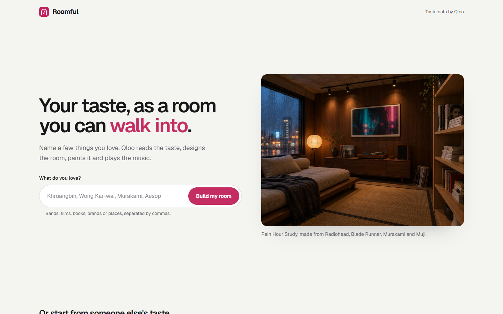
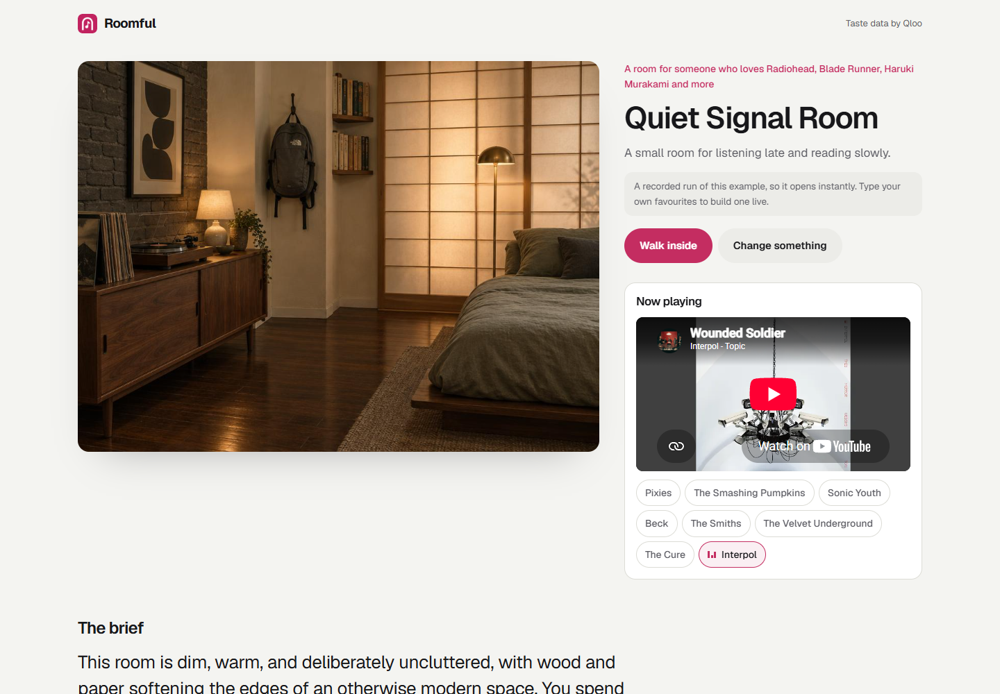

# Roomful


**Name a few things you love. Walk into the room they make, with the music on.**



Run it with `npm run start:room` (port 3301), or deploy with `SITE=room`.

## Judge in 60 seconds

1. Open the site and click the **Quiet Signal Room** example. It is a recorded real run, so it opens in seconds.
2. Look at the room: the painting, the name, and the first track playing from the room's Qloo playlist.
3. Scroll to **Every choice, and the taste behind it**: each design choice names the Qloo result behind it. Anything Qloo did not return is marked unverified.
4. Read **With and without Qloo**: the same favourites given to an LLM alone, each of its picks checked against Qloo.
5. Click **Walk inside**. On the rain example this opens a real 3D room built from the painting by Hunyuan World (on fal): walk with W, A, S and D, look with the arrow keys or by dragging, or press Enter VR on a headset. Other rooms open fal's real-time world model instead.

[Watch the explainer](video/roomful.mp4)

## Try it in 10 seconds

| Example | Favourites | Link |
|---|---|---|
| Quiet Signal Room | Radiohead, Blade Runner, Haruki Murakami, Muji | `/?demo=rain` |
| Velvet Speakeasy Lounge | Phoebe Bridgers, Fleabag, Sally Rooney, Glossier, Dr. Martens | `/?demo=heartbreak` |
| Art Deco Court | Kendrick Lamar, Nike, Jordan Peele films, Issa Rae, Lakers | `/?demo=courtside` |



## Where Qloo comes in

```
your favourites ──► Qloo /search ──► entities
                                       │  signal.interests.entities
                                       ▼
            Qloo /v2/insights: the rooms (decor, ambience tags), the playlist,
            the shelf and the screen (artists, books, films, brands), the crowd's ages
                                       │
                                       ▼
            an LLM writes the room from those names only ──► the painting ──► walk inside
```

| Step | Qloo call |
|---|---|
| Find your favourites | `GET /search?query=…` (a hit only counts if it shares a real word with what you typed); `/v2/tags` as a fallback |
| Rooms people with your taste rate | `GET /v2/insights?filter.type=urn:tag&filter.parents.types=urn:entity:place&filter.tag.types=urn:tag:decor:qloo` (and `ambience`, `interests`) with `signal.interests.entities=<favourites>` |
| The playlist, shelf and screen | `GET /v2/insights?filter.type=urn:entity:artist` (and `book`, `movie`, `brand`) with the same signal |
| Who shares the taste | `GET /v2/insights?filter.type=urn:demographics&signal.interests.entities=<favourites>` |

## With and without Qloo

After the room is written, the same favourites go to an LLM with no tools, and each of its 8 picks (3 decor or mood words, 3 artists, 2 brands) is checked against what Qloo returned for that taste:

| Example | Picks that hold up without Qloo |
|---|---|
| Quiet Signal Room | 0 of 8 |
| Velvet Speakeasy Lounge | 3 of 8 |
| Art Deco Court | 2 of 8 |

The LLM's picks are often real (Vangelis, Brian Eno, an Eames chair) but not what people with this taste actually rate, and some are not in Qloo at all ("Rain-Streaked Glass").

## Tests

```bash
npm test
```

```
✔ roomful: favourites become Qloo taste, the brief cites it, and an LLM alone is checked against it
✔ recorded examples replay without any API keys, with local images
✔ each site serves its own home at "/" with its own name, and nothing that belongs to another site
```

[`test/room.test.js`](../test/room.test.js) runs against a fake Qloo and a fake LLM. It checks that the favourites become the Qloo signal, that an invented name in the brief is flagged, that the "without Qloo" picks get the right verdicts (ranked, real but not ranked, not in Qloo), and that no key reaches the browser.

## Known limitations

- The painting is a generated image of a room that doesn't exist; the walkthrough improvises beyond it.
- The 3D room is reconstructed around the spot the painting was seen from, so walking is kept to a small circle there. Building one costs about $0.30 and 10 to 15 minutes, so only the rain example ships with one.
- Favourites Qloo doesn't know (or only knows as something else) are skipped rather than guessed.
- Music plays through YouTube embeds, found on the server without an API key; a track can occasionally be unavailable.

The pipeline lives in [`lib/room.js`](../lib/room.js).
