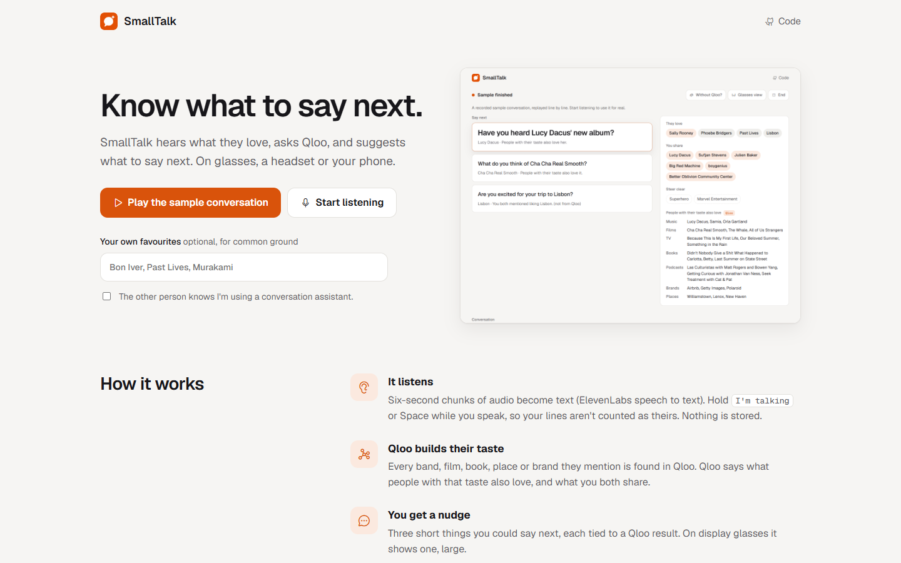

# SmallTalk


**It hears what the other person loves, builds their taste with Qloo, and tells you what to say next. On display glasses, a Quest headset, or a phone on the table.**



Run it with `npm run start:talk` (port 3303), or deploy with `SITE=talk`.

## Judge in 60 seconds

1. Open the site and click **Play the sample conversation** (or open `/?demo=sample`). A real recorded first coffee replays line by line.
2. Watch **They love**, **You share** and **Steer clear** fill in as they mention Sally Rooney, Phoebe Bridgers, Past Lives and Lisbon.
3. Read **Say next**: three things you could say, each tied to a Qloo result. A nudge that isn't from Qloo is marked.
4. When it finishes, click **Without Qloo?**: an LLM alone, given the same conversation, and how many of its suggestions actually fit their taste.
5. Click **Glasses view** for the one-nudge, white-on-black view for display glasses.

SmallTalk is shown in a live demo on a Quest headset rather than an edited video.


## Where Qloo comes in

```
what they say ──► speech to text ──► the names they mention
                                         │  /search (names), /v2/tags (genres)
                                         ▼
          Qloo /v2/insights, signal.interests.entities = what they love
          ├─ what people with that taste also love (music, films, TV, books, podcasts, brands, places)
          └─ + your own favourites, feature.explainability = what you both drive (common ground)
                                         │
                                         ▼
          three short nudges, citing only names Qloo returned
```

| Step | Qloo call |
|---|---|
| Find what they mention | `GET /search?query=…&types=urn:entity:<kind>`; a hit only counts if it shares a real word with what was said |
| Genres they like or avoid ("superhero films") | `GET /v2/tags?filter.query=…`, kept as tags, never matched to a title |
| What people with their taste also love | `GET /v2/insights?filter.type=urn:entity:<type>&signal.interests.entities=<their entities>` |
| What you have in common | the same, signalled by both of you, with `feature.explainability=true`; a pick counts as shared when both sides drive at least a quarter of it |

## With and without Qloo

**Without Qloo?** sends the same conversation to an LLM with no tools and asks what to bring up next. Each suggestion is checked against what Qloo returned for their taste. In the recorded sample, **1 of 6** fits (Aftersun). The others are real (Mitski, Fleabag, Sintra) but not what people with this taste rate.

## Consent and privacy

- It will not listen until you tick that the other person knows you are using a conversation assistant.
- Audio goes in 6-second chunks to speech to text (ElevenLabs, via fal) and is not stored.
- Qloo receives names of things (bands, films, places), never names of people in the conversation, and its results describe crowds, not individuals.

## Three ways to see it

- **Phone or laptop:** the full view.
- **Glasses view:** one nudge, huge, white on black, for display glasses mirroring a phone.
- **Enter AR / VR:** a thin bar just below your eye line, like a subtitle, shows the one thing to say next and updates as you talk. It runs in WebXR, with Quest passthrough when available ([`public/talk-xr.js`](../public/talk-xr.js)). Hold the trigger while you speak.

## Tests

```bash
npm test
```

```
✔ talk: consent first, typed or transcribed lines become a Qloo taste profile, nudges cite Qloo names
✔ recorded examples replay without any API keys, with local images
```

The SmallTalk test ([`test/pitch-talk.test.js`](../test/pitch-talk.test.js)) checks that nothing happens without consent; typed and transcribed lines both work; mentions resolve in Qloo; common ground comes from a combined signal with explainability; nudges not from Qloo are flagged; dislikes are kept apart; a disliked genre becomes a Qloo tag rather than a film with a similar name; the "without Qloo" picks get the right verdicts; and bad audio is refused.

## Known limitations

- It needs the other person to mention specific things. Small talk about the weather gives it nothing to work with.
- Speech to text can mishear names; you can type what they said instead.
- The AR/VR view was built for Quest's browser and has not yet been tested on a physical headset.

The session logic lives in [`lib/talk.js`](../lib/talk.js).
