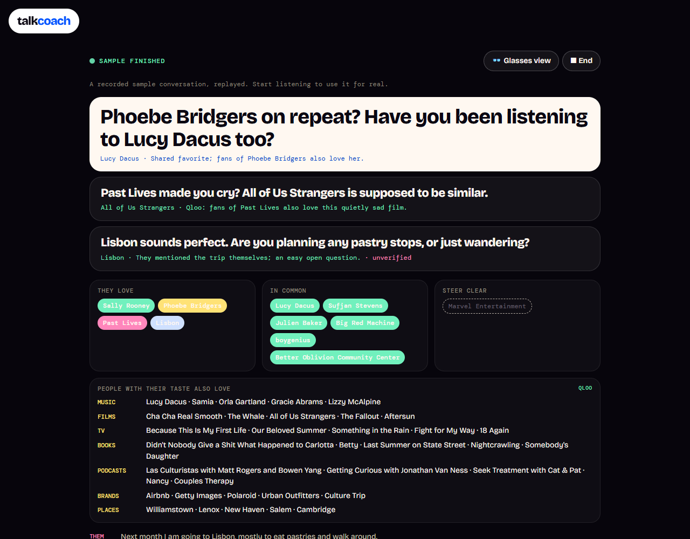

# Talk Coach

**It hears what the other person mentions, builds their taste as you talk, and tells you what to say next. On a phone on the table, display glasses, or a Quest headset.**

Run it with `npm run start:talk` (port 3303), or deploy with `SITE=talk`.

## Try it in 10 seconds

**Play the sample conversation** (or open `/?demo=sample`): a first coffee, replayed line by line from a real run. Watch the other person's taste fill in, the common ground appear, and the nudges change as they mention Sally Rooney, Phoebe Bridgers, Past Lives and Lisbon.

## How it works

1. **Consent first.** It will not listen until you tick that the other person knows.
2. **Listen.** The microphone records in 6-second chunks. Each chunk is transcribed (ElevenLabs speech to text, via fal). Hold **I'm talking**, the Space bar or the headset trigger while you speak, so your lines aren't counted as theirs. You can also type what they said.
3. **Resolve.** Every band, film, book, show, place or brand they mention is resolved in Qloo.
4. **Build their taste.** What else people with that taste love, what you have in common (from your own favourites, with explainability), and what to steer clear of (things they dislike).
5. **Nudge.** Three things you could say next, each tied to a Qloo result. Ungrounded nudges are marked.

## Three ways to see it

- **Phone or laptop:** the full view, with their taste, common ground and nudges.
- **Glasses view:** one nudge, huge, white on black, for display glasses mirroring a phone.
- **Enter AR / VR:** the nudges float in front of you in WebXR, with Quest passthrough when available ([`public/talk-xr.js`](../public/talk-xr.js)).

The session logic lives in [`lib/talk.js`](../lib/talk.js).
