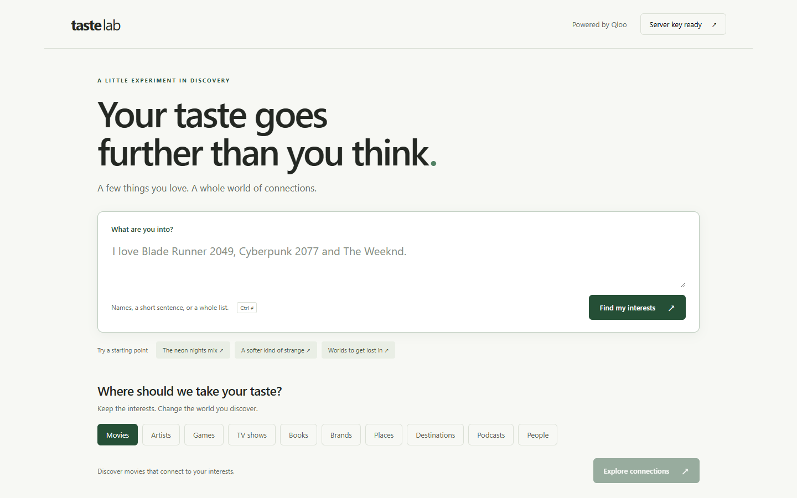

# Taste Lab

**The Qloo explorer the project started from: type interests, review every match, and see the exact request and response behind each recommendation.**

Run it with `npm run start:lab` (port 3304), or deploy with `SITE=lab`.

## What it's for

Builders. Before wiring Qloo into an agent, it helps to see what Qloo actually returns:

1. Type a few interests. Each one is matched with `/search`, and you confirm or swap the match.
2. Pick an output type (artists, films, places, brands and more) and get recommendations from `/v2/insights` with `signal.interests.entities`.
3. Open any result to see the raw request and response.

The Qloo key stays on the server; the browser only talks to `/api/lab/*`. The code lives in [`lab/`](../lab).
