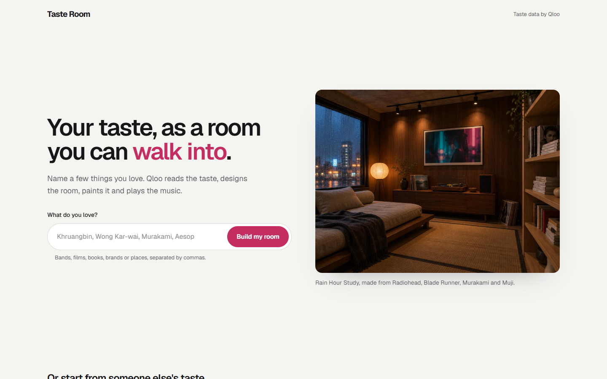
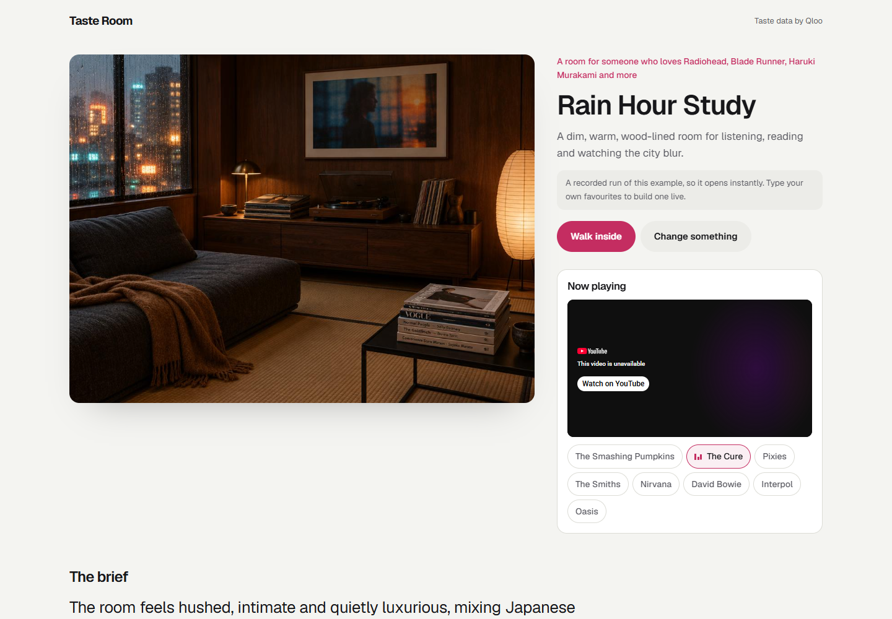

# Taste Room

**Name a few things you love. Walk into the room they make, with the music on.**

Run it with `npm run start:room` (port 3301), or deploy with `SITE=room`.

## Try it in 10 seconds

| Example | Favourites | Link |
|---|---|---|
| Rain Hour Study | Radiohead, Blade Runner, Haruki Murakami, Muji, Monocle | `/?demo=rain` |
| Velvet Bistro Bedroom | Phoebe Bridgers, Fleabag, Sally Rooney, Glossier, Dr. Martens | `/?demo=heartbreak` |
| Court Side Lounge | Kendrick Lamar, Nike, Jordan Peele films, Issa Rae, Lakers | `/?demo=courtside` |

## How it works

1. **Resolve.** Qloo turns each favourite into an entity (`/search`).
2. **Taste.** Qloo says which decor and ambience tags people with that taste rate highest, and what else they love: artists, films, books and brands.
3. **Brief.** An LLM writes the room. Every choice cites a name Qloo returned; anything else is flagged.
4. **Paint.** GPT Image 2.5 Flare paints the room, and the first track on the Qloo playlist starts playing (YouTube, resolved on the server with no API key).
5. **Walk inside.** The same live walkthrough as Openhere starts from the painting.
6. **Change it in a sentence.** "Warmer light, fewer plants" repaints the room and keeps the rest.

The pipeline lives in [`lib/room.js`](../lib/room.js).
